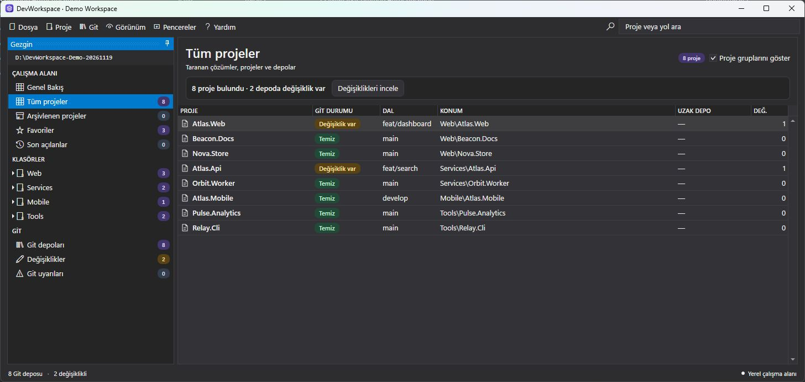
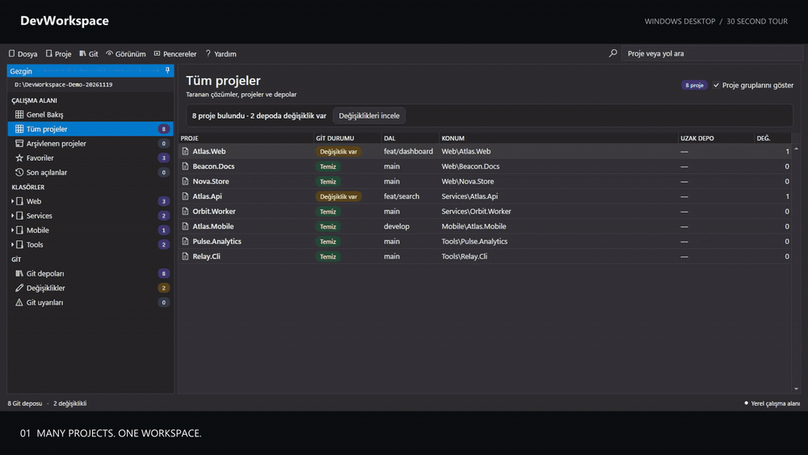
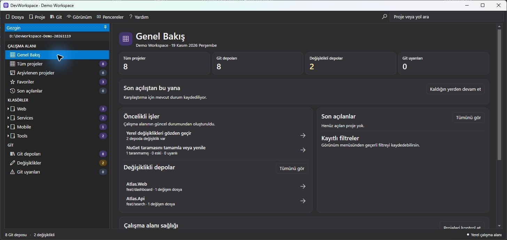
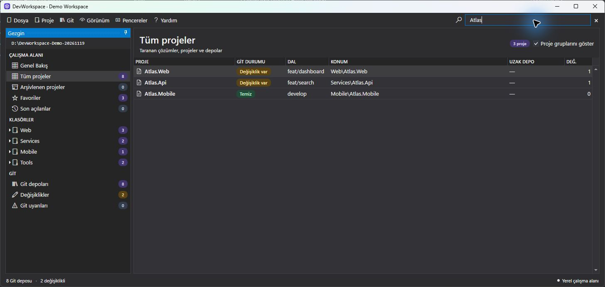
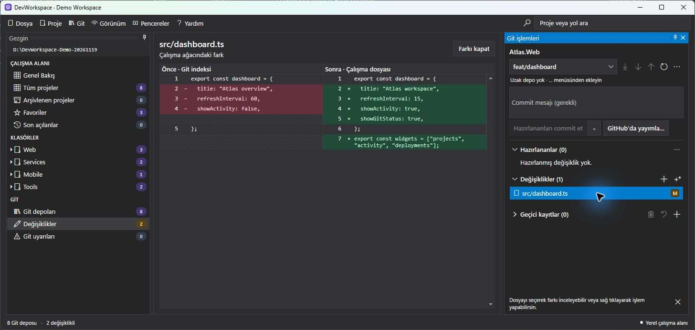

# DevWorkspace

**Many projects. One workspace.**

A Windows desktop workbench for developers juggling repositories, frameworks, and tools. Discover projects in a folder, see their Git status, inspect package vulnerabilities, and launch your development tools from one place.

[Türkçe](docs/README.tr.md) · [Report a bug](https://github.com/developersenturk/DevWorkspace/issues) · [Suggest a feature](https://github.com/developersenturk/DevWorkspace/issues)

**[Download for Windows x64](https://github.com/developersenturk/DevWorkspace/releases/latest/download/DevWorkspace-win-x64-Setup.exe)** · [Portable ZIP](https://github.com/developersenturk/DevWorkspace/releases/latest/download/DevWorkspace-win-x64-Portable.zip)

Install once to receive updates in the background. Ready updates apply on the next launch, or when you choose **Restart now**.




## See it in 30 seconds

[](https://github.com/developersenturk/DevWorkspace/blob/master/docs/media/devworkspace-demo.mp4)

[Watch or download the MP4](https://github.com/developersenturk/DevWorkspace/raw/refs/heads/master/docs/media/devworkspace-demo.mp4) · Project list → search → changed repositories → side-by-side Git diff.

Recorded in the real Windows application using local sample repositories. The interface is currently in Turkish. The demo is silent, with English captions.

<details>
<summary>More screenshots: workspace overview, search, and Git diff</summary>

**Workspace overview** — project counts and work that needs attention.



**Project search** — find related projects across folders.



**Git diff** — inspect changes alongside the Git workbench.



</details>

## Your development folder, with context

Which repository has uncommitted work? Where is that React client inside your .NET solution? Which package findings need attention before you pick up a project again?

DevWorkspace brings that context into a searchable desktop workspace.

| When you need to… | DevWorkspace helps you… |
| --- | --- |
| Find a project across folders and stacks | Discover projects from their manifests and group related components. |
| Pick up work across repositories | Check Git status, inspect diffs and history, and work with branches, remotes, and worktrees. |
| Review dependency security | Inspect NuGet findings and scan supported JavaScript and Dart lockfiles with OSV-Scanner. |
| Start your development workflow | Open project tools, run commands, and save launch profiles. |
| Keep a growing workspace organized | Use favorites, groups, saved filters, linked folders, and workspace import/export. |
| Check connected services | Inspect GitHub Actions runs and Docker Compose services when their tools are available. |

## Built for mixed stacks

Project detection includes **.NET, React, Next.js, Vue, Angular, Flutter/Dart, Python, Rust, Go, Java/Gradle, and CMake**, alongside game, mobile, and infrastructure project formats.

Detection identifies project files; build, run, and integration features depend on the project type and locally installed tools.

## Try it from source

**Requirements:** Windows x64, the .NET 10 SDK, and access to the DevExpress WPF packages used by this project. DevExpress is a commercial dependency with its own licensing requirements.

```powershell
git clone https://github.com/developersenturk/DevWorkspace.git
cd DevWorkspace
dotnet restore DevWorkspace.slnx
dotnet run --project src/DevWorkspace.csproj -c Debug
```

1. Select **Dosya → Çalışma alanı aç veya kur…** (`Ctrl+O`) and choose a development folder.
2. Browse discovered projects and select one to inspect its details and available actions.
3. Use `Ctrl+F` to search, `Ctrl+K` for the command palette, and `F5` to rescan.

The current interface is in **Turkish**. The application runs on Windows even when it recognizes projects targeting other platforms.

### Optional integrations

| Tool | Used for |
| --- | --- |
| Git | Repository status and Git operations |
| GitHub CLI (`gh`) | GitHub repository and Actions integration; requires authentication |
| OSV-Scanner | Supported JavaScript and Dart lockfile vulnerability scans |
| Docker with Compose | Compose service inspection and actions |
| Project SDKs and package managers | Commands for the projects you work on |

## Build and verify

```powershell
dotnet build DevWorkspace.slnx -c Debug
dotnet run --project tests/ProjectDetection/ProjectDetection.csproj -c Debug
```

The project-detection checks are a console executable, so run them with `dotnet run`.

To create a self-contained, single-file Windows x64 build:

```powershell
dotnet publish src/DevWorkspace.csproj -c Debug -r win-x64 --self-contained true -p:PublishSingleFile=true -p:EnableCompressionInSingleFile=true
```

The executable is written to `src/bin/Debug/net10.0-windows/win-x64/publish/`. This repository uses Debug for local build and verification.

## Help shape DevWorkspace

Automatic updates use Velopack and GitHub Releases. See [installation, update behavior, and publishing](docs/updates.md).

**Release Center** (Git → Release Center) prepares Debug Windows x64 packages from a captured source commit, uploads resumable drafts, verifies SHA-256 digests and publishes after GitHub Actions checks. It also shows per-release and per-asset downloads, repository stars/forks, CSV exports and a public update download probe. See the [Release Center guide](docs/release-center.md).

Try it against your own development folder and [tell us what you find](https://github.com/developersenturk/DevWorkspace/issues): a project type that was missed, a workflow that takes too many steps, or an integration you would use every day. Include the project type, expected behavior, and reproduction steps; remove private paths and credentials from attachments.

If DevWorkspace fits your workflow, a star helps other developers discover it.

**License:** No project license has been declared in this repository yet. Third-party dependencies retain their own licenses.
