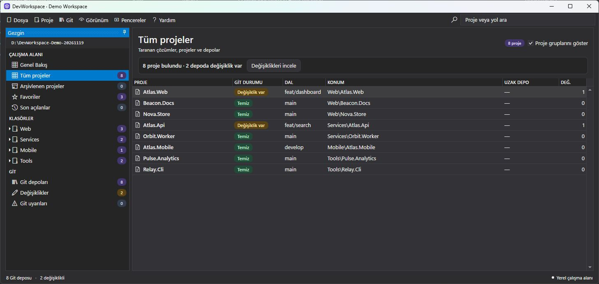
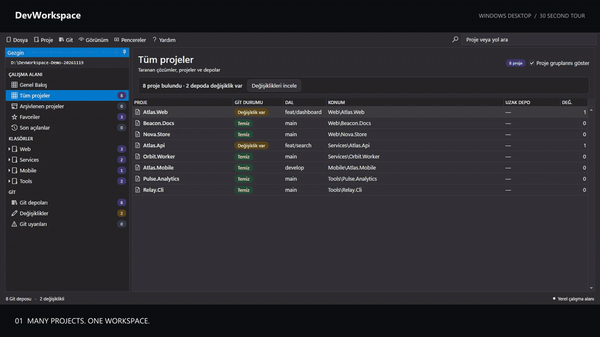
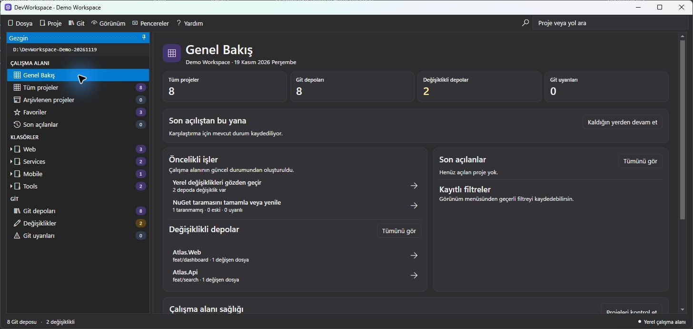
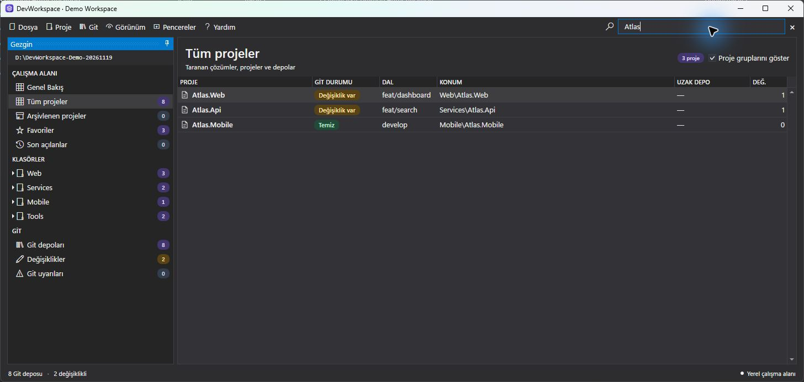
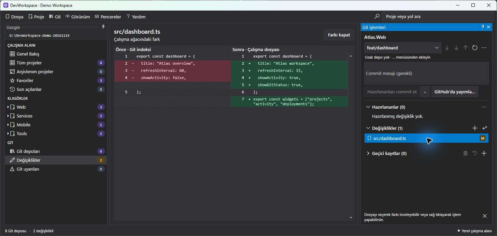

# DevWorkspace

**Çok proje. Tek çalışma alanı.**

Farklı klasörlere ve teknolojilere dağılmış projelerini tek Windows uygulamasında bul, Git durumlarını gör, paket güvenliği bulgularını incele ve geliştirme araçlarını aç.

[English](../README.md) · [Hata bildir / özellik öner](https://github.com/developersenturk/DevWorkspace/issues)

**[Windows x64 için indir](https://github.com/developersenturk/DevWorkspace/releases/latest/download/DevWorkspace-win-x64-Setup.exe)** · [Taşınabilir ZIP](https://github.com/developersenturk/DevWorkspace/releases/latest/download/DevWorkspace-win-x64-Portable.zip)

Bir kez kurduktan sonra güncellemeler arka planda indirilir. Hazır güncelleme sonraki açılışta veya **Şimdi yeniden başlat** düğmesiyle uygulanır.



## 30 saniyede DevWorkspace

[](https://github.com/developersenturk/DevWorkspace/blob/master/docs/media/devworkspace-demo.mp4)

[MP4 videoyu izle veya indir](https://github.com/developersenturk/DevWorkspace/raw/refs/heads/master/docs/media/devworkspace-demo.mp4) · Proje listesi → arama → değişiklikli depolar → yan yana Git diff.

Kayıt, gerçek Windows uygulamasında yerel örnek repolarla alındı. Demo sessizdir ve İngilizce açıklamalar içerir.

<details>
<summary>Diğer ekran görüntüleri</summary>

**Genel bakış**



**Proje arama**



**Git diff**



</details>

## Neyi kolaylaştırıyor?

- **Proje keşfi:** Geliştirme klasörünü tara; projeleri ve bağlı bileşenlerini birlikte gör.
- **Git çalışma alanı:** Durum, diff, geçmiş, branch, remote ve worktree işlemlerine ulaş.
- **Paket güvenliği:** NuGet bulgularını incele; desteklenen JavaScript ve Dart kilit dosyalarını OSV-Scanner ile tara.
- **Günlük akış:** Proje araçlarını aç, komutları çalıştır ve çalışma profillerini kaydet.
- **Düzen:** Favoriler, gruplar, kayıtlı filtreler ve bağlı klasörlerle projelerini organize et.
- **Entegrasyonlar:** Gerekli araçlar kuruluysa GitHub Actions çalıştırmalarını ve Docker Compose servislerini incele.

.NET, React, Next.js, Vue, Angular, Flutter/Dart, Python, Rust, Go, Java/Gradle ve CMake dahil birçok proje biçimini tanır. Bir projenin tanınması, tüm geliştirme işlemlerinin desteklendiği anlamına gelmez; kullanılabilen işlemler proje türüne ve kurulu araçlara bağlıdır.

## Başlangıç

Günlük iş akışları için [çalışma alanı araçları rehberine](workspace-tools.tr.md) bak: başlatma profilleri, dönüş notları, toplu Git özeti, çalışan uygulamalar, ortam kontrolü, içerik araması, bağımlılık haritası ve proje şablonları.

Windows x64, .NET 10 SDK ve projede kullanılan DevExpress WPF paketlerine erişim gerekir. DevExpress, kendi lisans koşulları olan ticari bir bağımlılıktır.

```powershell
git clone https://github.com/developersenturk/DevWorkspace.git
cd DevWorkspace
dotnet restore DevWorkspace.slnx
dotnet run --project src/DevWorkspace.csproj -c Debug
```

1. **Dosya → Çalışma alanı aç veya kur…** (`Ctrl+O`) ile geliştirme klasörünü seç.
2. Bulunan projelerden birini seçerek detaylarına ve işlemlerine ulaş.
3. `Ctrl+F` ile ara, `Ctrl+K` ile komut paletini aç, `F5` ile yeniden tara.

Arayüz Türkçedir. Farklı platformlara yönelik projeleri tanısa da uygulamanın kendisi Windows üzerinde çalışır.

Git işlemleri için Git, GitHub entegrasyonu için kimlik doğrulaması yapılmış GitHub CLI (`gh`), desteklenen JavaScript/Dart güvenlik taramaları için OSV-Scanner, Compose işlemleri için Docker ve Compose gerekir. Proje komutları ilgili SDK ve paket yöneticilerini kullanır.

## Derleme ve doğrulama

```powershell
dotnet build DevWorkspace.slnx -c Debug
dotnet run --project tests/ProjectDetection/ProjectDetection.csproj -c Debug
```

Tek dosyalı Windows x64 paketi oluşturma komutu [İngilizce README'de](../README.md#build-and-verify) bulunur.

## Deneyip fikrini paylaş

Tanınmayan bir proje türü mü var? Her gün kullandığın bir iş akışını kolaylaştırabilir miyiz? [Issue aç](https://github.com/developersenturk/DevWorkspace/issues); proje türünü, beklenen davranışı ve yeniden üretme adımlarını yaz. Eklerdeki özel yolları ve kimlik bilgilerini temizle.

İşine yaradıysa yıldız vererek projenin keşfedilmesine destek olabilirsin.

**Lisans:** Özgün kod [MIT lisanslıdır](../LICENSE). [Katkı rehberi](../CONTRIBUTING.md) ve [üçüncü taraf bildirimleri](../THIRD-PARTY-NOTICES.md) mevcuttur. DevExpress ticari lisansına tabidir.

Yeni kurulumlar İngilizce başlar; Ayarlar üzerinden Türkçe seçilebilir. Mevcut dil tercihleri korunur. İlk açılış rehberi Yardım menüsünden tekrar açılabilir. Profil düzenleyicisinden taşınabilir profil, Dosya menüsünden anonim HTML raporu paylaşılabilir. Yerel kullanım sayaçları varsayılan kapalıdır ve otomatik gönderilmez. [Gizlilik](privacy.md) · [İmzalama ve WinGet hazırlığı](distribution.md).
